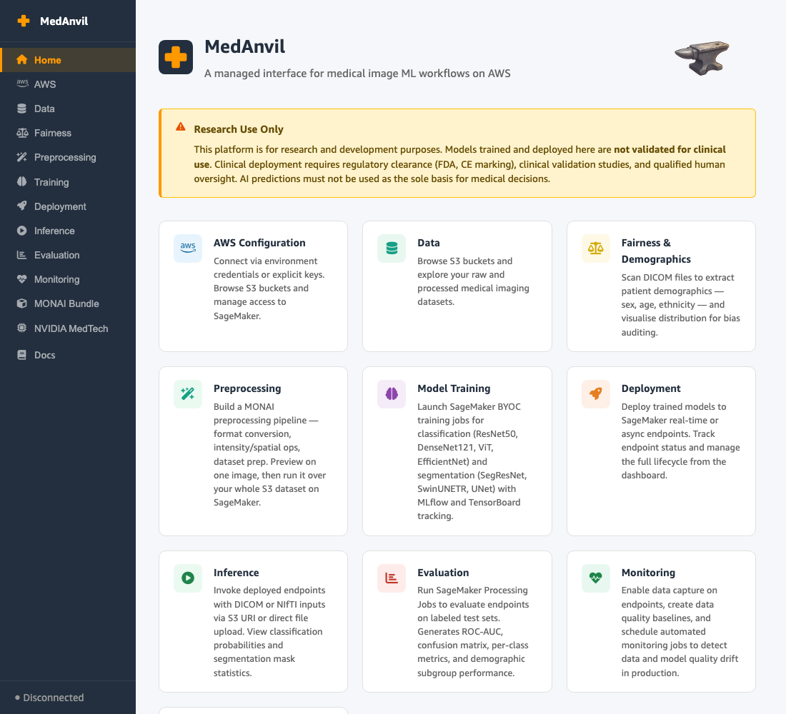
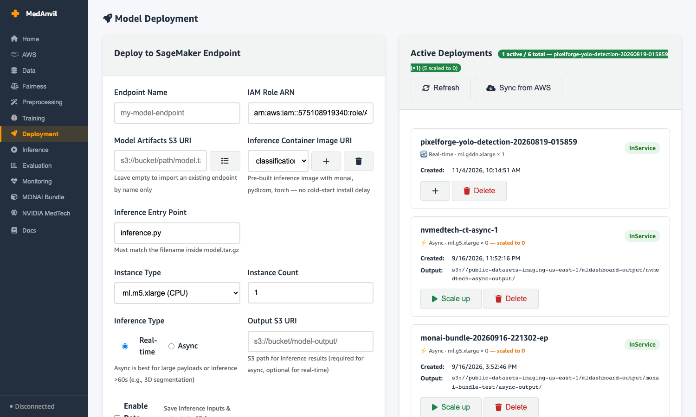
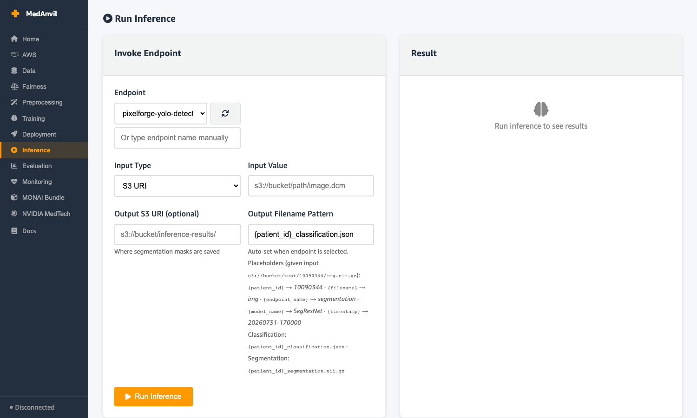
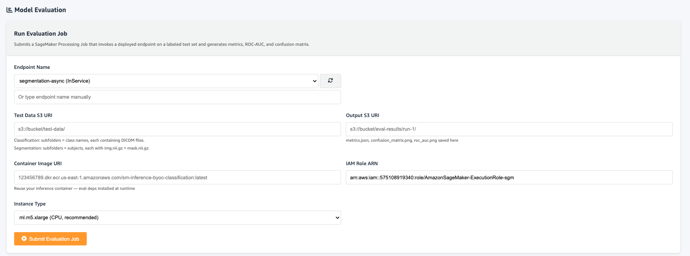
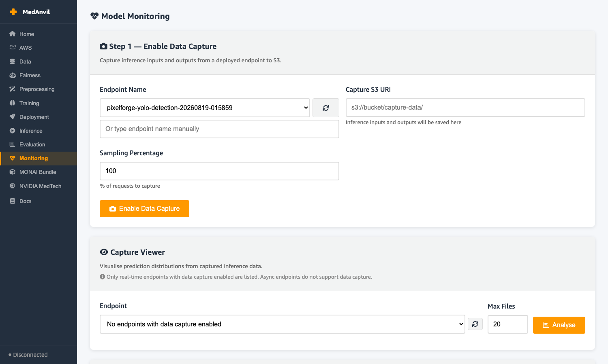
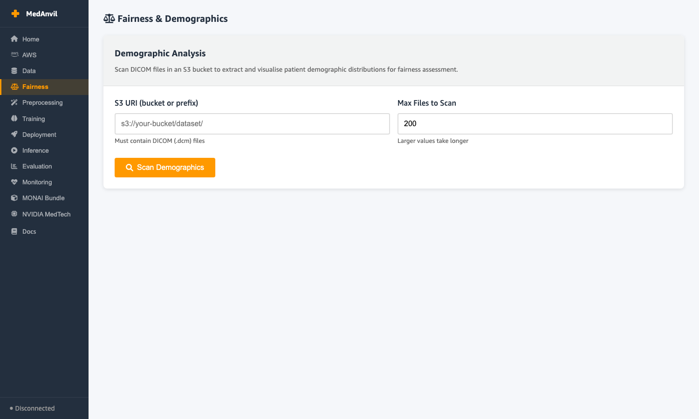
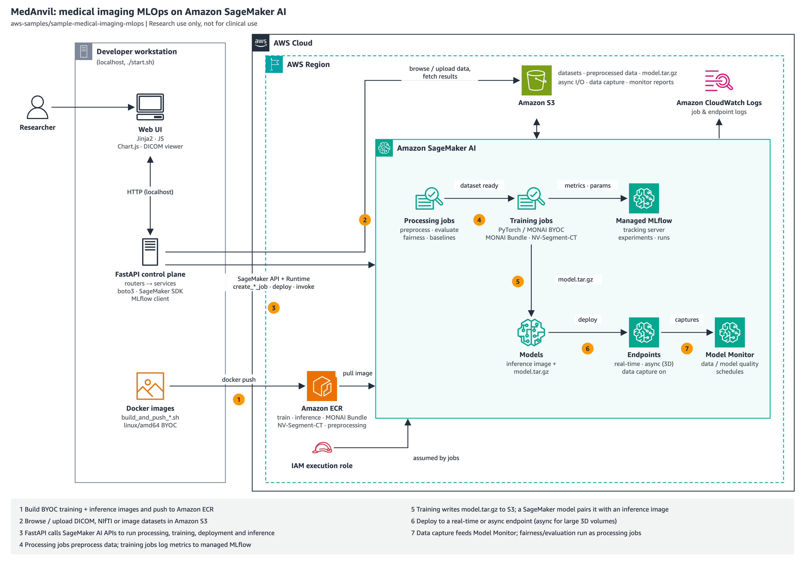

<p align="center">
  
</p>

<h1 align="center">MedAnvil</h1>

<p align="center">
  <strong>Train, deploy, and monitor medical imaging AI — from your browser.</strong>
</p>

<p align="center">
  <a href="#features">Features</a> •
  <a href="#how-it-works">How It Works</a> •
  <a href="#architecture">Architecture</a> •
  <a href="#getting-started">Getting Started</a> •
  <a href="#documentation">Documentation</a> •
  <a href="#responsible-ai">Responsible AI</a>
</p>

---

> **⚠️ Research Use Only** — Model outputs are not clinical diagnoses. Clinical deployment requires regulatory clearance (e.g., FDA), validation studies, and human-in-the-loop oversight.

---

## Why MedAnvil?

Building medical imaging AI typically means juggling scattered scripts, manual infrastructure, and disconnected experiment tracking. MedAnvil brings it all into one place:

- **One interface** for the entire ML lifecycle — data prep through production monitoring
- **Built for medical imaging** — native DICOM/NIfTI support, MONAI-powered architectures, and DICOM metadata-aware fairness analysis
- **Cloud-native on AWS** — SageMaker training, deployment, and monitoring with MLflow experiment tracking
- **No vendor lock-in** — open source, runs locally, brings your own AWS account

<p align="center">
  
</p>

---

## Features

### 🏋️ Train

Launch SageMaker training jobs with state-of-the-art architectures. Configure hyperparameters, data augmentation, and class balancing from the UI.

**Supported models:**
| Classification | Segmentation |
|---|---|
| ResNet50 | SegResNet |
| VGG-16 | SwinUNETR |
| DenseNet121 | UNet |
| EfficientNet-B0 | |
| Vision Transformer (ViT) | |
| Custom (bring your own) | |

All experiments are tracked in MLflow with full hyperparameter, metric, and artifact logging. Segmentation supports binary and multi-class label maps with configurable patch size.

### 🧹 Preprocess

Build a MONAI transform pipeline (resample, window, normalise, crop, resize and more), preview it on one image, then run the identical pipeline over an S3 dataset as a CPU SageMaker Processing Job. See the [Preprocessing guide](docs/user-guide/preprocessing.md).

### 📦 MONAI Bundle

Bring **any [MONAI Bundle](https://docs.monai.io/en/stable/bundle_intro.html)** into MedAnvil — the NVIDIA Model Zoo bundles (`spleen_ct_segmentation`, `wholeBody_ct_segmentation`, VISTA3D / NV-Segment-CT) or your own. From the **MONAI Bundle** tab:

- **Stage** a bundle by pasting its **MONAI model-zoo GitHub link** (or a Hugging Face URL / repo id) into S3 as a deployable `model.tar.gz`. Staged bundles show as cards with key papers, data organization, and a GitHub link — all read from the bundle's own `metadata.json`
- **Fine-tune** it on your MONAI Decathlon dataset on SageMaker (epochs, cache rate, LR, batch size, and arbitrary bundle config overrides); jobs are tracked under Active / Completed / Failed / Archived tabs
- **Deploy** the base or fine-tuned bundle to an **async** SageMaker endpoint (3D inference is slow/large-payload), with live status and a deployed-models list (scale to 0 / up / delete)
- **Infer** — the endpoint runs `monai.bundle run` on GPU and writes the segmentation mask as a `.nii.gz` to S3

One model-agnostic image serves any bundle; the model artifact is just `configs/` + `models/`. See the [MONAI Bundle guide](docs/user-guide/monai-bundle.md) for full instructions on bringing a new bundle to MedAnvil.

### 🧬 NVIDIA MedTech (NV-Segment-CT / VISTA-3D)
A dedicated tab for fine-tuning and running NVIDIA's NV-Segment-CT bundle on SageMaker. Fine-tuning uses the bundle's own continual-learning recipe, and async inference accepts optional label and point prompts. Weights are fetched from Hugging Face when you stage the bundle and are never stored in git. CT only.

### 🖼 Prediction Viewer (experimental)
A full-page NiiVue viewer at `/viewer` for NIfTI and DICOM, with multiplanar and 3D views, mask overlays and a per-label legend. Volumes stream from S3 through the backend, so no bucket CORS setup is needed. See the [Viewer guide](docs/user-guide/viewer.md).

### 🚀 Deploy

One-click deployment to SageMaker endpoints. Choose real-time or async inference. Monitor endpoint health and auto-scaling from the dashboard.

<p align="center">
  
</p>

### 🔬 Invoke

Test deployed models directly from the browser. Upload DICOM/NIfTI files, paste S3 URIs, or use local samples. See predictions with confidence scores and visual overlays for segmentation.

<p align="center">
  
</p>

### 📊 Evaluate

Run structured evaluation jobs against live endpoints. Get per-class metrics, confusion matrices, ROC curves, and exportable reports.

<p align="center">
  
</p>

### 📈 Monitor

Set up SageMaker Model Monitor with data capture, quality baselines, and drift detection schedules. Get alerted when your model's inputs or outputs shift.

<p align="center">
  
</p>

### ⚖️ Fairness

Scan DICOM metadata for demographic distributions (age, sex, ethnicity). Audit training data representation and model performance across subgroups before deployment.

<p align="center">
  
</p>

### 📝 Report

Auto-generate structured paper sections — abstract, methods, results, discussion — from completed training and evaluation jobs. Export for publication workflows.

### 🔄 Fine-tune

Resume training from checkpoints with full lineage tracking. Know exactly which base model, data version, and hyperparameters produced each artifact.

---

## How It Works

```
┌─────────────────────────────────────────────────────────────────┐
│                        MedAnvil Dashboard                        │
│                     (FastAPI + Jinja2 + JS)                      │
└──────────┬──────────────────────────────────┬───────────────────┘
           │                                  │
           ▼                                  ▼
┌─────────────────────┐           ┌─────────────────────────┐
│    AWS SageMaker     │           │       MLflow Server      │
│  • Training Jobs     │           │  • Experiment Tracking   │
│  • Endpoints         │           │  • Model Registry        │
│  • Model Monitor     │           │  • Artifact Store        │
│  • Processing Jobs   │           │                          │
└──────────┬──────────┘           └─────────────────────────┘
           │
           ▼
┌─────────────────────┐
│      Amazon S3       │
│  • Training Data     │
│  • Model Artifacts   │
│  • Data Capture      │
│  • Evaluation Results│
└─────────────────────┘
```

1. **Prepare** — Point MedAnvil at your imaging data in S3 (DICOM or NIfTI)
2. **Train** — Select an architecture, configure hyperparameters, launch a SageMaker training job
3. **Track** — All metrics, parameters, and artifacts logged to MLflow automatically
4. **Deploy** — Push your best model to a SageMaker endpoint with one click
5. **Evaluate** — Run batch evaluation jobs and review per-class performance
6. **Monitor** — Set up data quality baselines and drift detection schedules
7. **Iterate** — Fine-tune from checkpoints, compare experiments, and improve

---

## Architecture

<p align="center">
  
</p>

| Layer | Technology |
|---|---|
| **Frontend** | Jinja2 templates, vanilla JavaScript, Chart.js |
| **Backend** | Python, FastAPI, boto3 |
| **ML Framework** | PyTorch, MONAI |
| **Experiment Tracking** | MLflow (SageMaker-managed or local) |
| **Training & Inference** | AWS SageMaker (BYOC containers) |
| **Storage** | Amazon S3 |
| **Container Registry** | Amazon ECR |

---

## Getting Started

### Prerequisites

- Python 3.10+
- AWS account with SageMaker access
- AWS CLI configured with appropriate credentials
- Docker (for building training/inference containers)

### Install & Run

```bash
# Clone the repo
git clone https://github.com/aws-samples/sample-medical-imaging-mlops.git
cd sample-medical-imaging-mlops

# Configure environment
cp .env.example .env
cp .env.local.example .env.local   # Add your AWS account ID, role ARN, ECR URIs

# Start the application
./start.sh
```

The start script handles:
- Virtual environment creation
- Dependency installation (uses [uv](https://github.com/astral-sh/uv) if available, falls back to pip)
- MLflow server startup (local or SageMaker-managed)
- Application launch

Open **http://localhost:8000** and you're ready to go.

### Build SageMaker Containers

```bash
./start.sh --build
```

Builds and pushes the 4 core images to ECR:
- Classification training container
- Segmentation training container
- Classification inference container
- Segmentation inference container

The preprocessing, MONAI Bundle and NVIDIA MedTech images have their own scripts. Run the ones you need:

```bash
./build_and_push_preprocessing.sh
./build_and_push_monai_bundle.sh
./build_and_push_monai_bundle_inference.sh
./build_and_push_nvmedtech.sh
./build_and_push_nvmedtech_inference.sh
```

---

## Documentation

📖 **Official docs: [aws-samples.github.io/sample-medical-imaging-mlops](https://aws-samples.github.io/sample-medical-imaging-mlops/)**

Comprehensive documentation is also available in the [`docs/`](docs/) directory:

- **[Getting Started](docs/getting-started.md)** — Setup, prerequisites, and first training job
- **[Configuration](docs/configuration.md)** — Environment variables, AWS setup, and customization
- **[API Reference](docs/api-reference.md)** — Full REST API documentation
- **[Deployment Guide](docs/deployment-guide.md)** — Production deployment on AWS
- **[User Guide](docs/user-guide/)** — Feature walkthroughs for every tab
- **[Development](docs/development.md)** — Contributing, testing, and architecture details
- **[Custom Model Workflow](docs/custom-model-workflow.md)** — Bring your own model architecture
- **[Changelog](CHANGELOG.md)** — Release notes and upgrade steps (rebuild and re-push all images after upgrading to 1.1.0)

## Security

MedAnvil has **no built-in login** and acts with your AWS credentials, so it listens on `127.0.0.1` only. Reach it from another machine through an SSH tunnel, not by binding it to a wider address.

- The dashboard rejects unexpected `Host` headers and cross-site write requests (DNS rebinding and CSRF protection). Set `ALLOWED_HOSTS` if you use a tunnel under another hostname.
- Set `AWS_ACCOUNT_ID` in `.env.local` so job code is only uploaded to S3 buckets your account owns.
- Inference endpoints accept local file paths only under `LOCAL_INPUT_ROOTS`; set `ALLOWED_INPUT_BUCKETS` to limit which buckets requests can read.

See [Configuration](docs/configuration.md#dashboard-security-settings) and [Development → Security](docs/development.md#security). If you find a security issue, please report it through [AWS vulnerability reporting](https://aws.amazon.com/security/vulnerability-reporting/) rather than opening a public GitHub issue.

---

## Responsible AI

MedAnvil is a research tool. If you are considering clinical deployment, the following apply:

| Consideration | Guidance |
|---|---|
| **Not a medical device** | AI predictions are for research only — not clinical diagnoses |
| **Human oversight** | Qualified healthcare professionals must review all model outputs |
| **Regulatory clearance** | Clinical use requires FDA 510(k)/De Novo, CE marking, or equivalent |
| **Clinical validation** | Retrospective metrics ≠ prospective clinical evidence |
| **Fairness & bias** | Use built-in fairness analysis to audit demographic representation |
| **Data privacy** | Ensure HIPAA/GDPR compliance when handling patient data |
| **Reproducibility** | All experiments are tracked with full provenance metadata |

---

## Contributing

We welcome contributions! See [`docs/development.md`](docs/development.md) for setup instructions, coding standards, and the pull request process.

```bash
# Run tests
pytest

# Run with coverage
coverage run -m pytest && coverage report
```

---

## License

This project is licensed under the [MIT-0 License](LICENSE).

---

<p align="center">
  Built with <a href="https://monai.io/" target="_blank" rel="noopener noreferrer">MONAI</a> · Powered by <a href="https://aws.amazon.com/sagemaker/" target="_blank" rel="noopener noreferrer">AWS SageMaker</a>
</p>
